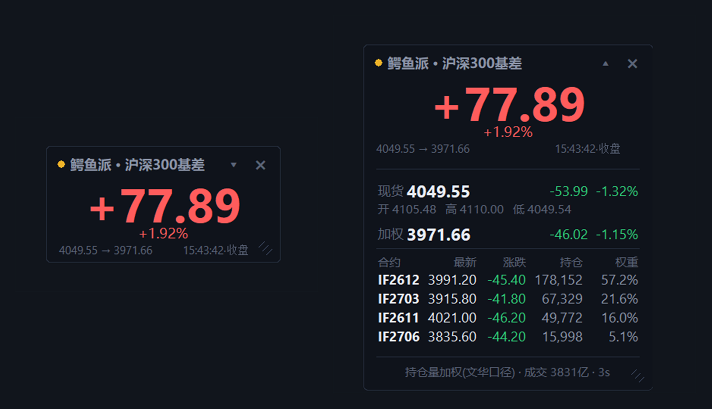

# 鳄鱼派 · 沪深300 基差悬浮窗

<p align="center"></p>


> **鳄鱼派粉丝**出品的巴掌大置顶小窗：只把「沪深300 现货 − 持仓量加权 IF」这一个数钉在屏幕角落。
> **按 Win+D 显示桌面也不会被最小化**（原生实现，不用装 AutoHotkey）。



左边是默认的紧凑态（248×124），右边点 ▾ 展开后的详情态。

---

## 为什么需要它

在文华/同花顺里看「300股指加权」要开一堆窗口、来回切页，而盘中真正想瞄一眼的往往只有一个数：**基差**。

基差就是「期货比现货贵还是便宜」。机构拿 IF 做空对冲，会把期货压得比现货便宜；对冲盘一撤，价差就开始往回缩。盯着这一个数，有时比刷十条新闻更直接。

这个工具把它单独拿出来，做成一个不挡事的小浮窗：

- 只占 248×124 像素，贴在屏幕角落不碍事；
- 始终置顶，切到任何软件都还在；
- **Win+D 也不会消失**（这正是很多人做置顶工具时踩的坑）；
- 想细看时点一下 ▾，完整展开。

## 特性

- **只显示一个数**：基差点数 + 基差率 + 方向，红正绿负，一眼可读
- **展开即详情**：现货开/高/低、涨跌，期货加权价与涨跌，每个 IF 合约的最新价 / 涨跌 / 持仓 / 权重
- **不被 Win+D 干掉**：给窗口加上 `WS_EX_TOOLWINDOW` 扩展样式（论坛里那个 AHK `winset, ExStyle, ^0x80` 方案的原生版），天然排除在「显示桌面」之外
- **不占任务栏、不出现在 Alt+Tab**：`WS_EX_TOOLWINDOW` 顺带解决
- **自动换月**：按 CFFEX 当前挂牌的合约动态取数，自动跳过已到期合约，不用每月改代码
- **持仓量加权**：`Σ(最新价 × 持仓量) / Σ持仓量`，对齐文华「300股指加权」口径（**不是**成交量加权）
- **状态一眼可见**：绿点=实时，黄点=收盘/非交易时段，红点=取数失败重试中
- **自由缩放**：拖右下角那三道斜线，75% ~ 250% 任意放大缩小，大屏小屏都看得清（缩放比例会记住）
- **能自己更新**：启动后自动查 GitHub Releases，有新版就在窗口下方弹提示，点「立即更新」自动下载、替换、重启；也能在右键菜单里手动检查
- **无控制台黑窗**：双击 .py 会自动用 `pythonw` 重启自己
- **单实例**：重复双击不会开出第二个窗口
- **记忆**：位置、展开状态、刷新间隔都记住
- **开机自启**：右键菜单一键开关（写入「启动」文件夹快捷方式）

## 下载即用（推荐，不需要装 Python）

到 [Releases](https://github.com/wwwwww1239/hs300-basis-widget/releases) 页面下载 **`eyupai-hs300-basis-v1.1.0.exe`**（约 14 MB，单文件），双击就能用，不用装 Python、不用 pip。

> 第一次运行 Windows 可能弹「Windows 已保护你的电脑」→ 点「更多信息」→「仍要运行」。这是没买代码签名证书的正常提示。
>
> 附件用英文名是为了兼容性：GitHub 对非 ASCII 文件名偶尔会显示成乱码/截断，所以发布文件统一用 `eyupai-hs300-basis` 这个英文标识（"鳄鱼派" 的拼音），程序本身的窗口标题、图标仍然是中文的鳄鱼派。

## 快速开始（从源码跑）

**环境**：Windows 10/11 + Python 3.8 以上

```bat
:: 1. 安装唯一依赖
pip install requests

:: 2. 运行（或者直接双击 鳄鱼派_沪深300基差.py）
python 鳄鱼派_沪深300基差.py
```

第一次双击时如果闪过一个黑窗，是 `python` 启动自身的控制台，脚本会立刻用 `pythonw` 无控制台重启，之后不再出现。

> 想固定在一个位置常驻：右键 →「开机自启动」打勾。

## 使用说明

| 操作 | 效果 |
| --- | --- |
| 点右上角 `▾` / `▴` | 展开 / 收起详情 |
| 双击窗体空白处 | 同样展开 / 收起 |
| 按住窗体拖动 | 移动位置（退出后位置会记住） |
| **拖右下角三道斜线** | **整体缩放 75% ~ 250%**（小屏调小、大屏调大，比例会记住） |
| 点右上角 `✕` | 退出 |
| 右键 | 菜单：检查更新、展开/收起、刷新间隔、立即刷新、始终置顶、开机自启动、回到屏幕右上角、退出 |

颜色约定：**红 = 基差为正（期货比现货便宜），绿 = 基差为负（期货比现货贵）**，跟随 A 股习惯。

## 基差怎么看（大白话版）

不用管什么叫「升水」「贴水」，记住一句话就行：**看基差大不大、在变大还是在变小。**

基差 = 沪深300 现货 − 期货加权价，可以把它当成「机构有多怕」的体温计：

| 屏幕上看到 | 说明什么 |
| --- | --- |
| **基差很大**（比如 +80、+100） | 期货比现货便宜一大截，说明一堆机构在拿空单对冲、一致看空，市场情绪悲观、避险 |
| **基差在变小**（比如 100 → 60 → 30） | 做空对冲的力量在撤退，大家没那么慌了 —— **这是好事**，情绪在修复，风险偏好会从低位慢慢爬回来 |
| **基差变成负数** | 期货比现货还贵，多头情绪很强、甚至有点兴奋（分红、资金成本也会把期货抬上去，未必全是看多） |
| **基差突然变大** | 恐慌盘、对冲盘在加码，要小心 |

一句话口诀：

> **基差缩小是好事，基差变大要警惕。**
> 不管当天指数是涨还是跌，只要基差往回缩，就说明恐慌式的做空在退潮，愿意裸多的人变多了。

再补两点：

- 极端大的基差，往往对应阶段性的悲观共识底部；
- 基差快速收缩，常常是反弹的前奏。

> 注意：分红季（IF 分红会自然压出较大的基差）、合约临近到期、资金成本都会影响基差，别只盯一个数，配合成交量和持仓变化看更稳。

## 口径与算法

```
基差      = 沪深300 现货指数 − IF 持仓量加权价
加权价    = Σ(最新价 × 今日持仓量) / Σ今日持仓量
加权基准  = Σ(昨收盘 × 昨日持仓量) / Σ昨日持仓量   ← 与文华「300股指加权」的涨跌口径对齐
涨跌      = 最新价 − 昨收盘（合约与加权都用昨收，跟文华终端显示一致）
覆盖合约  = 当月、下月、当季、下季（自动探测，自动过滤已到期）
数据源    = 新浪财经免费行情  hq.sinajs.cn
            现货 sh000300，期货 CFF_RE_IF2601 这类代码
刷新频率  = 默认 3 秒（可在右键菜单改成 1/2/3/5/10/30 秒）
```

> 为什么加权基准要用「昨日持仓量」：文华的加权指数是连续序列，涨跌是拿今天的加权价去减**昨天那个指数值**；而昨天的指数值用的是昨天的持仓权重。我们用今天的权重去加权昨天的收盘价会差一分两分钱，改用昨仓后实测和文华对到小数点后一位（例：-46.02 vs 文华 -46.0）。

**关于抖动**：现货指数约 5 秒一个快照，期货是 tick 级，两边时点不完全对齐，所以基差会跳几分钱。文华终端里同样会跳，属正常现象。

**关于非交易时段**：收盘后显示当日收盘数据并标记「收盘」；周末/节假日显示上一交易日数据，状态点变黄，不会假装还在跳。

## 技术细节：为什么它不会被 Win+D 最小化

Win+D（显示桌面）走的是 Shell 的「显示桌面」逻辑，它会遍历顶层窗口并最小化；而带 `WS_EX_TOOLWINDOW`（`0x00000080`）扩展样式的窗口会被当作「工具窗口」，**不进任务栏、不进 Alt+Tab、也被排除在显示桌面之外**。

```python
style = GetWindowLongW(hwnd, GWL_EXSTYLE)
SetWindowLongW(hwnd, GWL_EXSTYLE, (style | 0x80) & ~0x00040000)  # 加 TOOLWINDOW，去 APPWINDOW
SetWindowPos(hwnd, HWND_TOPMOST, 0, 0, 0, 0, SWP_NOMOVE | SWP_NOSIZE | SWP_FRAMECHANGED)
```

这就是那篇帖子里 `winset, AlwaysOnTop, , A` + `winset, ExStyle, ^0x80, A` 两行 AHK 做的事情。区别是：这里用 `ctypes` 直接调用 `user32`，不用额外装 AutoHotkey、不用常驻脚本。

另外还有一个 900ms 的「保活」检查：万一窗口被其他软件挤掉、被最小化、被藏起来，会自动恢复置顶与可见，作为兜底。

## 常见问题

**Q：跑起来没看到窗口？**
多显示器 / 高 DPI 缩放时可能落在看不见的位置。右键菜单 →「回到屏幕右上角」，或删掉 `%LOCALAPPDATA%\HS300BasisWidget\settings.json` 后重启。

**Q：显示「行情获取失败」？**
新浪免费接口偶尔抽风或断网。脚本每 3 秒自动重试并重新建连，恢复后自动正常，不用管。

**Q：需要开户 / 付费行情吗？**
不需要。数据全部来自新浪财经公开接口，免费、无需账号。

**Q：会被杀毒软件拦吗？**
脚本只调用了 `user32` 的 4 个函数（取/设窗口样式、置顶、检测最小化），不注入进程、不 Hook 键盘，代码全部可见，可自行审查。开机会在「启动」文件夹里创建一个快捷方式（可在菜单里关掉）。
「自动更新」只会访问 `api.github.com` 查最新 Release，下载的 exe 会先校验 MZ 头和体积再替换；不想要可以直接点「以后再说」或删掉 `settings.json` 里的 `skip_version`。

**Q：怎么开 / 关自动检查更新？**
启动 8 秒后自动查一次，之后右键菜单随时可以手动检查。发现新版会在窗口下方弹一个小提示：点「立即更新」→ 下载新 exe → 覆盖旧文件 → 自动重启；点「以后再说」就是跳过这个版本，之后不再打扰。
源码模式（跑 .py）不会自动替换文件，会帮你打开 Release 页面手动下载。

**Q：想改外观 / 尺寸 / 刷新频率？**
文件顶部有可调参数：

```python
REFRESH_SEC = 3                    # 默认刷新间隔（秒）
EXTRA_QUARTERS = 3                 # 探测后续季月合约数量
INTERVAL_CHOICES = (1, 2, 3, 5, 10, 30)
COMPACT_W, COMPACT_H = 248, 124    # 紧凑态尺寸
EXPANDED_W = 306                   # 展开态宽度
```

**Q：能打包成 exe 发给没装 Python 的人吗？**

本项目已经打包好了（见上面的 Releases）。想自己重新打包：

```bat
pip install pyinstaller
pyinstaller -F -w -n eyupai-hs300-basis --icon 鳄鱼派.ico --add-data "鳄鱼派.ico;." 鳄鱼派_沪深300基差.py
```

生成的 `dist\eyupai-hs300-basis.exe` 可以直接发给别人双击运行（图标就是仓库里的 `鳄鱼派.ico`，源图是那只鳄鱼摆件）。发布到 Releases 时把文件名带上版本号即可，例如 `eyupai-hs300-basis-v1.1.0.exe`。

## 更新日志

### v1.1.0 (2026-10-28)

- **右下角拖拽缩放**：拖窗口右下角的三道斜线，整体缩放 75% ~ 250%，字号、排版、圆角一起等比放大，比例写入配置
- **在线更新**：启动 8 秒后自动检查 GitHub Releases；发现新版在窗口下方弹提示，exe 模式点「立即更新」会下载 → 覆盖 → 自动重启；源码模式跳转下载页；支持「以后再说」（跳过该版本）
- 右键菜单新增「检查更新」/「新版本 vX · 点此更新」
- 紧凑态右下角时间右移，给缩放抓手让位

### v1.0.0 (2026-10-27)

首个公开版本：

- 紧凑态基差显示（点数 / 基差率 / 升贴水方向）+ 点击展开详情
- 持仓量加权口径，自动换月、自动过滤到期合约
- `WS_EX_TOOLWINDOW` 实现 Win+D 不被最小化、不进任务栏 / Alt+Tab
- 右键菜单：刷新间隔、置顶、开机自启、复位、退出
- 位置 / 展开状态 / 刷新间隔持久化，单实例，pythonw 无控制台启动
- 提供单文件 exe（PyInstaller 打包，带鳄鱼图标），发给没装 Python 的人也能直接双击

## 依赖

- Python 3.8+（标准库 `tkinter`、`ctypes`、`threading`、`json`）
- [`requests`](https://pypi.org/project/requests/)

```bat
pip install -r requirements.txt
```

## 免责声明

本项目仅为个人看盘便利工具。行情数据来自第三方免费接口，可能延迟、缺失或出错；基差计算口径为作者个人对齐文华终端的结果，不保证与任何商业终端完全一致。文中关于基差与市场情绪的描述属于经验性解读，**不构成任何投资建议，据此交易风险自负。**

## 关于

作者是**鳄鱼派**的粉丝，这个工具纯属个人作品、用爱发电，**与鳄鱼派官方无关**；名字里带「鳄鱼派」只是致敬。

图标取自自己的那只鳄鱼摆件照片，抠图后压在米色圆角底板上。

欢迎提 Issue / PR。

## License

[MIT](LICENSE)

---

## English

**Crocodile Pie (鳄鱼派) · CSI 300 Basis Widget**

A tiny always-on-top desktop widget for the **CSI 300 basis**: the spot index minus the open-interest-weighted IF futures price. It stays visible after **Win+D** (Show Desktop) because the window carries the `WS_EX_TOOLWINDOW` extended style — the same trick AHK scripts use (`winset, ExStyle, ^0x80`), implemented natively with `ctypes` (no AutoHotkey needed).

- Compact mode (248×124 px) shows only the basis number, its percentage and the premium direction.
- Click `▾` (or double-click) to expand: spot OHLC, weighted futures price, and every listed IF contract with price / change / open interest / weight.
- Auto contract rollover, right-click menu (refresh interval, always-on-top, autostart, quit), position & state persistence, single instance, no console window.

**What the number means**: a widening discount (basis falling) means hedgers are aggressively shorting futures; a **narrowing discount (basis rising) means hedging pressure is fading** — institutions are no longer uniformly bearish, and risk appetite usually recovers from the lows. Whether the index rises or falls, a converging basis is generally a good sign.

**Requirements**: Windows 10/11, Python 3.8+, `pip install requests`.

```bat
python 鳄鱼派_沪深300基差.py
```

Data comes from Sina Finance's free quotes endpoint (`hq.sinajs.cn`). For personal use; not investment advice. MIT licensed.
